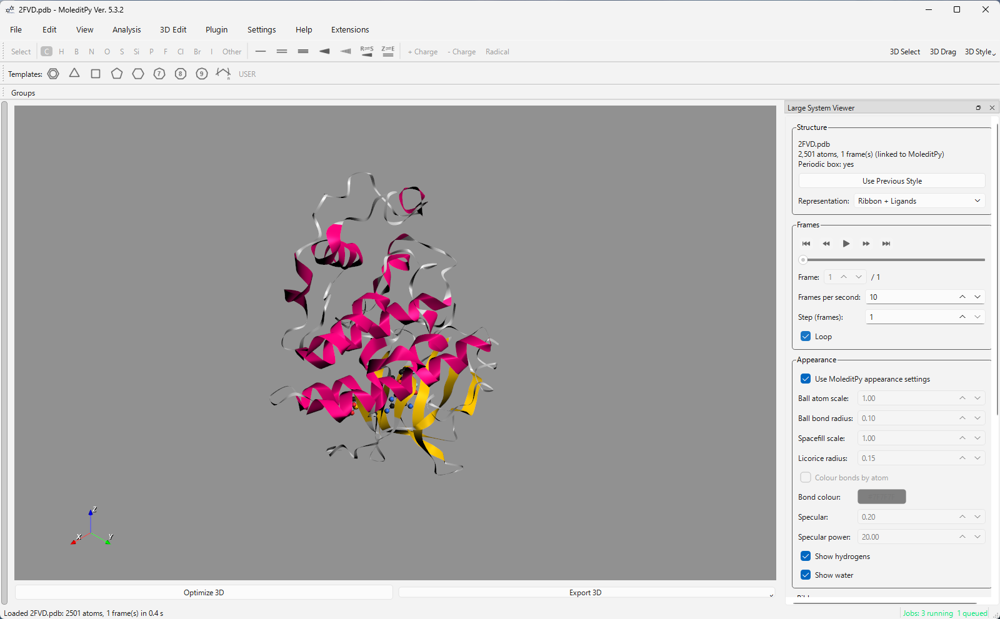
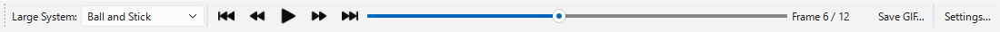
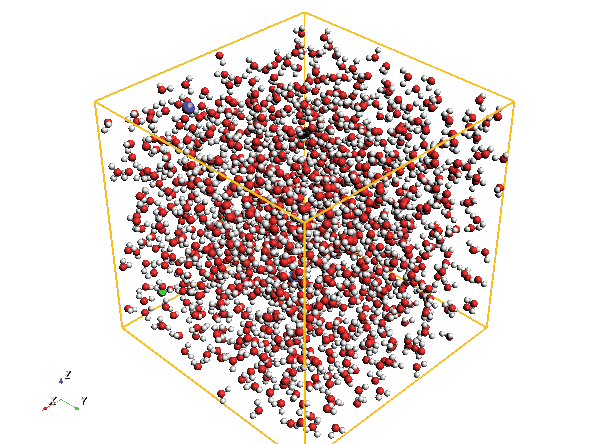
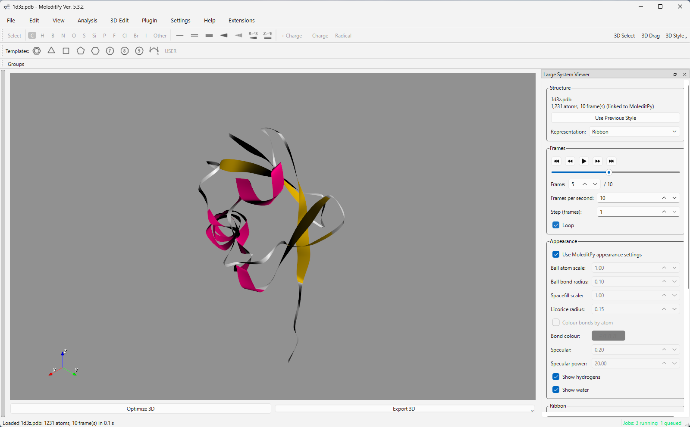
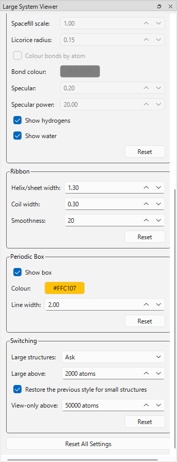

# MoleditPy Large System Viewer

[](https://github.com/HiroYokoyama/moleditpy_large_system_viewer/actions/workflows/test.yml)
[](https://github.com/HiroYokoyama/python_molecular_editor)
[](https://github.com/HiroYokoyama/moleditpy_large_system_viewer/tags)

A **MoleditPy** plugin for large systems: proteins drawn as ribbons, solvated MD boxes of
hundreds of thousands of atoms, and multi-frame PDB / GRO / XYZ / SDF trajectories with
playback, all inside MoleditPy's own 3D view.

Repo: [https://github.com/HiroYokoyama/moleditpy_large_system_viewer](https://github.com/HiroYokoyama/moleditpy_large_system_viewer)


---

## Key Features

- **Large System (Fast) 3D style**: atoms and bonds are drawn by VTK's impostor molecule
  mapper (spheres and cylinders computed on the GPU), so 100,000 atoms open in under a
  second and stay smooth to rotate. It can be chosen from the 3D Style menu for any structure.
- **Ask before switching**: when a structure above the threshold (2,000 atoms by default)
  arrives under another style, the plugin asks whether to switch. Yes is the default, No
  keeps the current style, and "Do not ask again" remembers the answer.
- **Representations**: Ball and Stick, Spacefill, Licorice, Ribbon, Ribbon + Ligands.
- **Ribbon colours**: by secondary structure (helix, sheet and coil colours of your choice),
  rainbow from the N to the C terminus, by chain, or one colour; ribbon and atom opacity.
- **Toolbar**: representation, frame controls and the settings at the bottom (or top) of
  the main window.
- **Trajectories**: multi-model PDB, GRO, multi-frame XYZ and multi-record SDF play with
  first / previous / play / next / last buttons, a slider, frame rate, step and loop.
  PDB, GRO and XYZ frames are read lazily from a memory-mapped file, so long trajectories
  are never loaded whole; SDF records are read into memory when the file opens.
- **Linked to MoleditPy**: the paused frame is written into the current molecule, so
  measurement, 3D image export and other plugins work on it. Files above the view-only
  limit (50,000 atoms by default) are shown by the plugin alone.
- **Periodic box**: GRO box lines (triclinic included), PDB `CRYST1` and extended-XYZ
  `Lattice=` cells are drawn and can be switched off; colour and line width are settings.
- **MoleditPy appearance**: radii, bond colour, CPK colours, lighting and background follow
  MoleditPy's 3D settings, or the plugin's own values when you turn that off.
- **Works with the CIF Viewer**: CIF supercells above the threshold are offered the Fast style
  and keep the CIF Viewer's cell overlays.







---

## Usage

1. Open a `.pdb`, `.ent`, `.gro`, `.xyz` or `.sdf` file (File > Open, File > Import, the
   command line or drag and drop). Small single-frame files open exactly as before.
2. For a large structure, answer **Yes** to use the Fast style. The toolbar appears and
   the settings window opens beside the 3D view (both can be turned off).
3. Choose a representation and play the frames from the toolbar. Open the settings from the
   toolbar's **Settings...** button or **Settings > Large System Viewer Settings...**.
4. To leave the Fast style, choose another style from MoleditPy's **3D Style** menu.



### Settings

The settings are on tabs, in a separate window or (a setting) the right-hand panel, and
are saved in `settings.json` beside the plugin. Each tab has its own Reset button. A field
reacts to the mouse wheel only after you click it, so scrolling never changes a value.



| Tab | Settings |
|---|---|
| Structure | representation, frames per second, step, loop, play back and forth |
| Appearance | use MoleditPy appearance settings, ball atom scale, ball bond radius, spacefill scale, licorice radius, colour bonds by atom, bond colour, specular, specular power, show hydrogens, show water, atom opacity, ligand style for Ribbon + Ligands |
| Ribbon | colour by (secondary structure / rainbow / chain / single colour), helix, sheet, coil and single colours, helix/sheet width, coil width, smoothness, opacity |
| Box | show box, colour, line width |
| Behaviour | large-structure action (ask / always switch / keep), threshold, restore the previous style for small structures, view-only limit, settings in a window or the right-hand panel, open the settings for a large structure, show the toolbar, toolbar at the bottom or top |

Projects (`.pmeprj`) remember the trajectory file, frame and representation, and reattach
the trajectory on load when the file is still there.

---

## Limitations

- Supports MoleditPy installed with pip. The packaged exe/app builds are not supported.
- STL/OBJ export needs real meshes, which the Fast style does not create for atoms and
  bonds; switch to a standard style to export (a pure ribbon exports). 3D image export works.
- Atom labels, aromatic rings and stereo labels are not drawn in the Fast style. Double and
  triple bonds known from an SDF file or the MoleditPy molecule are drawn as parallel
  cylinders; aromatic bonds, and all bonds found by distance, are drawn as single bonds.
- Bonds come from the first frame (distance test plus PDB `CONECT`); bonds across periodic
  boundaries are not drawn.
- Secondary structure comes from PDB `HELIX`/`SHEET` records; MD output without them is
  drawn as coil. Binary trajectories (XTC, DCD) are not read.
- Editing coordinates in 3D (3D Drag) detaches the structure from its trajectory; reopen
  the file to play it again.

See [DESIGN.md](DESIGN.md) for the design and measurements.

---

## Installation

1. Ensure MoleditPy (pip) is installed.
2. Install **Large System Viewer** from the [MoleditPy Plugin Explorer](https://hiroyokoyama.github.io/moleditpy-plugins/explorer/?q=Large+System+Viewer),
   or copy the `large_system_viewer/` folder into your plugins directory:
   - **Windows**: `C:\Users\<YourName>\.moleditpy\plugins\`
   - **Linux / macOS**: `~/.moleditpy/plugins/`
3. Restart MoleditPy.

No extra packages are needed: the plugin uses the numpy, RDKit, VTK and PySide6 that
MoleditPy already installs.

---

## Testing

```bash
cd moleditpy_large_system_viewer
python -m pytest tests/ -v
```

The tests run headlessly. `tests/test_api.py` checks the plugin's MoleditPy API use when
the main app repository is checked out beside this one.

---

## License & Disclaimer

Licensed under the GNU Lesser General Public License v3.0 — see [LICENSE](LICENSE) for details.
Provided *as is* without warranty. Please [open an issue](https://github.com/HiroYokoyama/moleditpy_large_system_viewer/issues) if you find a bug.

## Licensing scope

First-party code is LGPL-3.0-or-later. See [LICENSE](LICENSE), [COPYING](COPYING) and [dependency/provenance terms](LICENSING.md). Third-party components retain their own terms.
